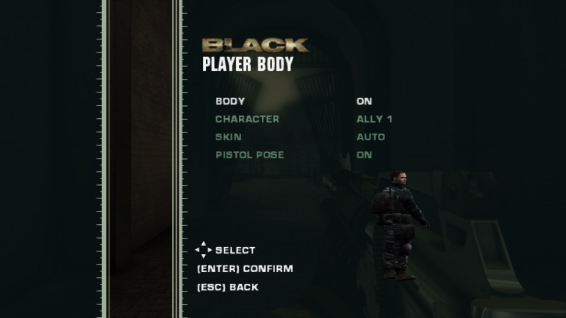
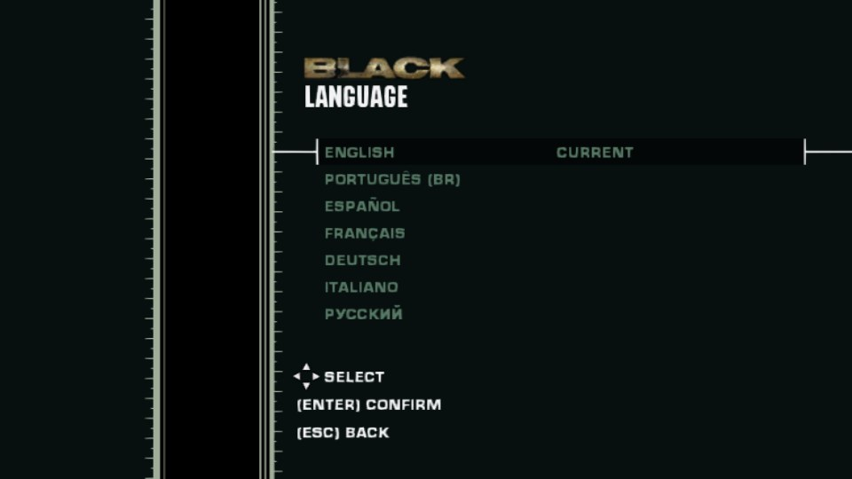
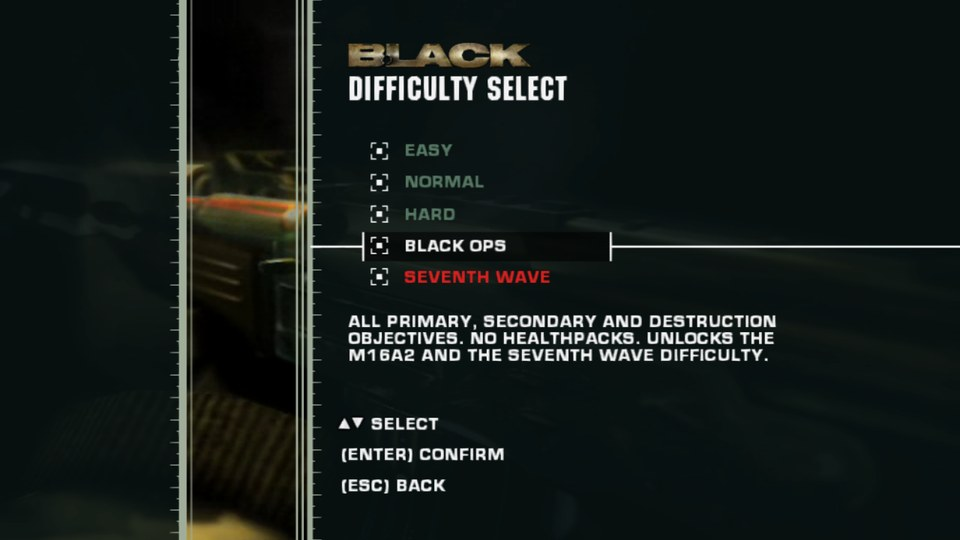
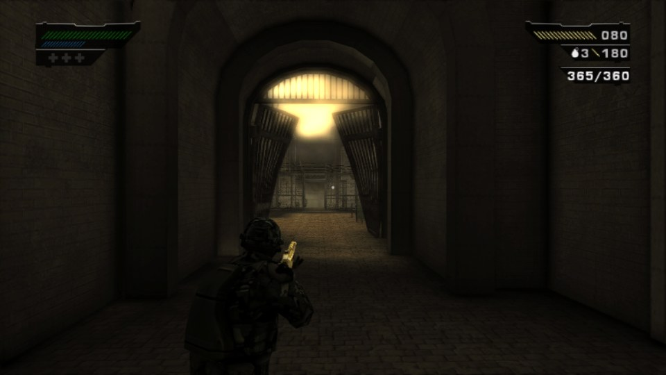
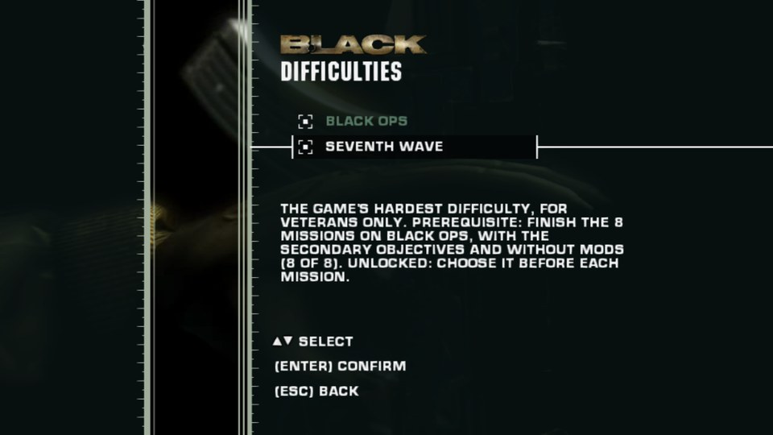
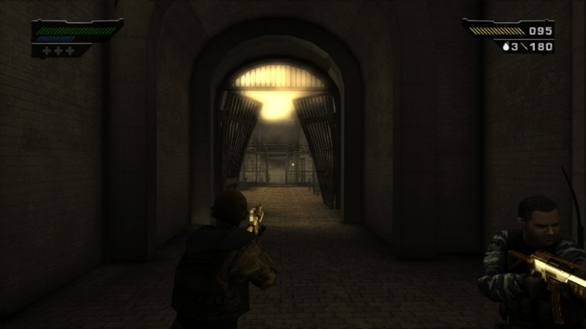
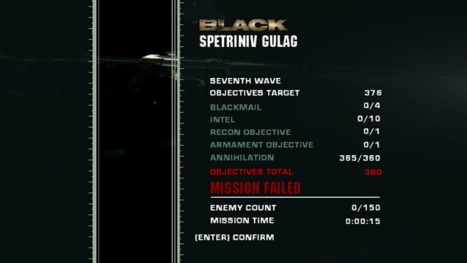
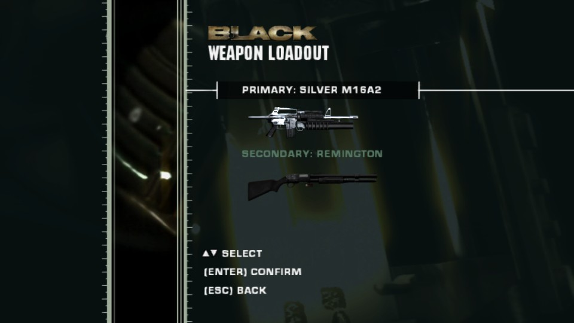
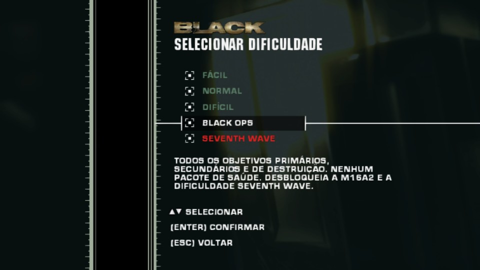
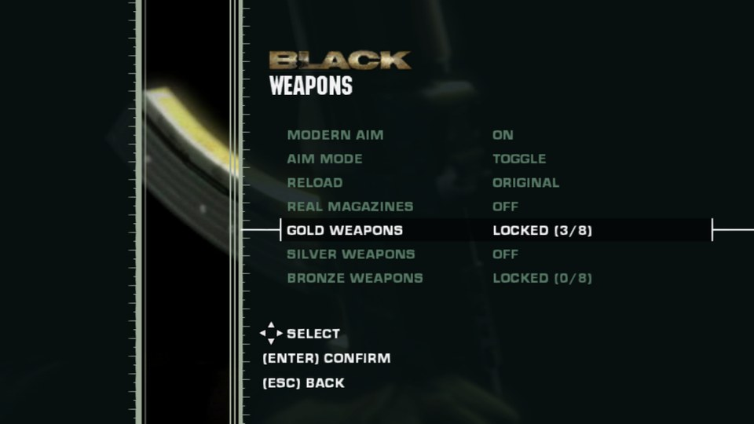

# BLACK Reloaded Mod

**Mods for BLACK (Criterion Games, 2006) in a single `winmm.dll`: jump, sprint, lean, noclip, fall damage, free camera,
third person with a body, modern aim, a weapon loadout with a suppressor, dual weapons and a shield, cheats, gold,
silver and bronze weapons, camouflages, enemy multiplier, enemy health, squad mode, the challenge mode that was cut
from the game with a realistic mode and a speedrun, a fifth difficulty, an UNLOCKABLES screen, the whole game in 7
languages and a MODS page, where almost everything turns on, off and is adjusted while you play.**

[**Download**](../../releases/latest) · [Português (Brasil)](README.pt-BR.md) · [Compatibility](#compatibility) ·
[Install](#install) · [The mods](#the-mods) · [Troubleshooting](#troubleshooting)



## Compatibility

Version **2.0** is made for the **XBE Recomp of BLACK, version V3 or newer**, with the **US disc**: the original one
or the same disc with the **PT-BR translation**.

| | Original game (US disc) | Game with the PT-BR translation |
|---|---|---|
| **XBE Recomp V3 or newer** | ✔ the game and the mod in 7 languages | ✔ the game and the mod in 7 languages |

| Package | Languages | Mods |
|---|---|---|
| `BLACK_Reloaded_Mod_2.0_XBERecomp.zip` | English, Português (BR), Español, Français, Deutsch, Italiano, Русский, chosen at every start | 38 |

The languages are covered in [Languages](#languages).

## Contents

- [Compatibility](#compatibility)
- [Highlights](#highlights)
- [Languages](#languages)
- [Requirements](#requirements)
- [Install](#install)
- [Update and uninstall](#update-and-uninstall)
- [Keys](#keys)
- [The mods](#the-mods)
- [Challenge mode](#challenge-mode)
- [Seventh Wave](#seventh-wave)
- [Unlockables and rewards](#unlockables-and-rewards)
- [The MODS page and black_mods.ini](#the-mods-page-and-black_modsini)
- [How it works](#how-it-works)
- [Troubleshooting](#troubleshooting)
- [Screenshots](#screenshots)
- [Version history](#version-history)
- [Rights](#rights)
- [Credits](#credits)

## Highlights

- **The challenge mode is back, now with a realistic mode.** The mode that was cut from the game returns on the main
  menu with two types: REALISTIC (every secondary objective, real magazines, no HUD, enemies that fall in 2 or 3 hits
  and throw grenades) and SPEEDRUN, with records per mission and difficulty.
- **The whole game in 7 languages.** English, Português (BR), Español, Français, Deutsch, Italiano and Русский, for
  the game's own texts and the mod's, chosen on the first page at every start.
- **Choose your weapons, and how you hold them.** Before each mission, a page with all 16 weapons as 3D models lets
  you pick the primary and the secondary, with a suppressor, two of the same weapon (one in each hand) or a riot
  shield.
- **Third person with a real body.** A camera behind the character or over the shoulder, 8 characters with their skins,
  and a body that uses the enemies' own shotgun, run and melee animations.
- **Unlockables.** A screen on the main menu lists what the game and the mod unlock, with the progress toward each
  one: weapon colours, five camouflages, difficulties, the Weapon Loadout's modifiers and the game's cutscenes.
- **A fifth difficulty, the Seventh Wave.** Black Ops with twice the enemies, no healthpacks and a minimum of fallen
  enemies to finish each mission.
- **Lean around corners.** Hold `CapsLock` and press `A` or `D`; the bullets and the shells come from the leaned weapon.
- **Options in the menus.** The MODS page, on the pause menu and the main menu, holds most options, and each change
  applies at once and is saved; the rest are in `black_mods.ini`.
- **Rewards for playing it straight.** Missions finished without mods unlock the silver M16A2, the Seventh Wave, the
  gold weapons and the cheats; the realistic mode unlocks the Bronze Weapons, with explosive shots; a fast speedrun of
  the whole game unlocks QUICK HANDS.
- **Light on the game.** The mod takes about 0.2 ms of each frame.
- **No game files.** The mod's menu pages, translated text tables, weapon colours and camouflages are made on the spot
  from your own copy of the game.

## Languages

- **Seven languages, chosen at every start.** The LANGUAGE page is the first thing the game shows: ENGLISH, PORTUGUÊS
  (BR), ESPAÑOL, FRANÇAIS, DEUTSCH, ITALIANO and РУССКИЙ, each written in itself. Back keeps the current one. A
  language other than the one the game started in restarts the game by itself, already in that language (a few
  seconds), because the recomp keeps its own PC prompts in the first language it showed them in. The choice is kept as
  `language` in `[mods]` of `black_mods.ini`.
- **The whole game, not only the mod.** Every text of the game (1,724: menus, objectives, hints, mission names,
  messages, credits) and every text of the mod is translated. The videos and the voices stay as they are.
- **Fonts.** The game's fonts have no Russian letters and no ã or õ: the mod adds them, drawn in the game's style.
- **No text runs over another.** Each text has a place on screen with a width in every language, checked when the mod
  is built; the UNLOCKABLES descriptions were also checked on screen in the 7 languages.
- **The PT-BR translated disc.** The Portuguese is the mod's own translation, the same on both discs. With the PT-BR
  disc, ENGLISH changes only the mod's texts: that disc has no English text of the game.
- **Progress.** The mod's progress and records are the same in every language.



## Requirements

Your copy of the game: the **NTSC-U (US) Xbox disc**, original or with the **PT-BR translation** (made on that disc).
Other regions are not supported.

- The XBE Recomp of BLACK, **version V3 or newer**, working with your copy of the game: `BLACK.exe`, the `compiler`
  folder and the game in the `assets` folder, as the disc image or as its extracted files, original or translated. The
  recomp shows its version at the bottom right of the main menu.
- Keep the `compiler` folder: the mod installs itself through it.

## Install

Download `BLACK_Reloaded_Mod_2.0_XBERecomp.zip` from the [Releases](../../releases/latest) page and unzip it.

1. Copy `winmm.dll` into the folder where `BLACK.exe` is:

   ```
   BLACK XBERecomp\
     assets\          (the disc image or its extracted files)
     compiler\
     hdd\
     BLACK.exe
     winmm.dll        <- the mod
   ```

2. Start the game with `BLACK.exe`, as usual.

The first time, the mod adds its hooks to the recomp's build and the recomp compiles the game again, which takes a
moment. When the recomp asks "The game is ready. Start the game now?", leave **Delete the compiler files** unticked.
The **LANGUAGE** page comes first; **CHALLENGE MODE**, **MODS** and **UNLOCKABLES** show up on the main menu, and
**MODS** on the pause menu.

## Update and uninstall

**Update from 1.9:** copy the new `winmm.dll` over the old one. 2.0 has other hooks, so the recomp compiles the game
again on the next start (it takes a moment, as on the first install). Your options (`black_mods.ini`), your progress
(`black_mods_gold.dat`, `black_mods_challenges.ini` and the game's own save) and your records stay; new options start
at their defaults. A `black_mods.ini` from 1.9 keeps its keys (`F1` free camera, `F3` third person); the new defaults
are `F1` third person and `F3` free camera (`key` in `[thirdperson]` and `[freecam]`). The speedrun records you
already have count toward QUICK HANDS.

**Uninstall:** with the game closed, run `Uninstall BLACK Reloaded Mod.bat` (in the package) from the folder of
`BLACK.exe`. It puts back the recomp's original build files (`compiler\config\game.toml` and `compiler\BLACK.lib`),
deletes `winmm.dll` and `Black.dll`, and the recomp compiles the original game on the next start. Do not just delete
`winmm.dll`: the game the recomp compiled with the mod needs it to start. If you want, also delete `black_mods.ini`,
the `black_mods*.log` files, `black_mods_gold.dat`, `black_mods_challenges.ini`, the `black_mods_skins` folder and the
`hdd\E\TDATA\45410083\ReloadedMod` folder.

## Keys

| Key | What it does |
|---|---|
| `C` | jump |
| `LCtrl` (hold) | sprint |
| `CapsLock` (hold) + `A` / `D` | lean left / right |
| `F1` | first person → third person → over the shoulder |
| `F2` | hide and show the HUD |
| `F3` | free camera |
| `F4` | noclip |
| `F9` | save the last 30 seconds of sound |
| `T` (the recomp's suppressor key) | on the Weapon Loadout: the MODIFIER of the weapon in focus |

Most options can be changed on the MODS page or in `black_mods.ini`; the free camera, the noclip, the HUD key, the
third person and the body's switch, the fall damage, the challenge mode, the realistic mode's damage, the Weapon
Loadout's switch and enemy drops, the dual weapons' and the shield's switches, the silver M16A2, the weapon finishes
and the finer settings of the other mods (jump speed and gravity, sprint speed and stamina, the lean's keys and angle,
enemy and squad distances, the body's poses) only in `black_mods.ini`. A `black_mods.ini` from an earlier version
keeps its keys.

## The mods

38 mods. Most of them turn on and off on the MODS page and apply in the same game (the free camera, the noclip, the HUD
key, the third person, the fall damage and the challenge mode in `black_mods.ini`). The full list is also in
`MOD-LIST.html`, inside the package.

### Movement

- **Jump** (`C`): the character can jump. Speed and gravity can be adjusted in `black_mods.ini`, and each jump costs
  15% of the sprint's stamina.
- **Sprint** (`LCtrl`, hold): runs 1.6× faster, moving forward only. The stamina lasts 6 s and shows as a blue bar below
  the health. In first person the rifles, the shotguns, the MP5 and the P90 are carried low across the body like the
  WA2000 walking (a shot or a reload comes first); in third person the body runs with the weapon low, like the soldiers.
- **Lean** (`CapsLock` + `A` / `D`): holding `CapsLock`, `A` and `D` lean the view out 35 cm and tilt it 16° instead of
  strafing. The weapon, the bullets, the muzzle flash and the ejected shells come from the leaned weapon, so you can
  fire around a corner; the view does not go through walls. First person only. A controller button can be set too
  (held, the left stick leans).
- **Noclip** (`F4`): goes through walls, floors and objects and flies where you look, without losing control of the
  weapon. Good for exploring the levels for hidden things.
- **Fall damage:** falls hurt, measured from the highest point of the fall. Nothing up to 3 m, then more and more until
  a fall of 12 m kills. Both heights can be changed in `black_mods.ini`.

### Camera and visuals

- **Free camera** (`F3`): a loose camera that flies around the level while the game keeps running. The mouse wheel
  changes its speed.
- **HUD key** (`F2`): hides and shows the HUD. It comes back by itself on pauses, menus and cutscenes, so no message is
  ever hidden.
- **Third person** (`F1`): switches between first person, a camera behind the character and a camera over the
  shoulder. The camera avoids walls, the shot goes along the line of the crosshair, and aiming can go back to first
  person. With dual weapons it stays in first person.
- **Player body:** in third person a character stands in for the player, with 8 characters to choose from: the ally,
  with the skins of the game's three allies (VEBLENSK 1, VEBLENSK 2, NAZRAN TOWN, TIVLIZ ASYLUM), and the 7 enemies,
  with their named skins (GREEN CAMO, URBAN, DESERT CAMO, KAMYSH CAMO, BLUE NAVY CAMO, DIRT CAMO, BLACK CAMO...). On the
  MODS page (PLAYER BODY) the chosen character turns on a display beside the options. The barrel stays on the
  crosshair. With the SPAS-12 or the Remington the body aims, pumps and reloads shell by shell like the masked shotgun
  soldier, in time with your reload; the M249 is held at the shoulder with both hands; it walks and runs in 6
  directions, stays crouched only while standing still, shows your melee strike as the LMG soldier's strike, and shows
  the same suppressor as the first person. Only the footsteps of the character in view play. The body's switch is
  `body` in `[thirdperson]`.
- **Camouflages:** five PLAYER BODY skins, each for its character, with the name in yellow on the SKIN row: ARCTIC
  (militiaman), FURY (SPAS soldier), ELITE (balaclava soldier), CRIMSON (elite soldier) and MOTHERLAND (helmet
  soldier). Worn, in first or third person, you take 20% less damage of every kind and a melee strike kills any enemy
  (only the look in a speedrun, the realistic mode and the runs without mods). Each one unlocks by kills or intel files;
  see [Unlockables and rewards](#unlockables-and-rewards).
- **Modern aim:** when aiming, the weapon goes to the line of sight, with the rear and front sights at the centre of the
  screen, and stays still even while walking. The shotguns aim the same way. Weapons without an aim pose, like the P90,
  keep their crosshair. AIM MODE: TOGGLE (each press turns the aim on or off, the game's way) or HOLD (the aim lasts
  while the button is held).
- **Weapon finishes:** each collection of weapons has its own finish, made from the game's own textures: normal (steel wear
  on the edges), silver (brushed steel, matte black grip and stock), gold (brushed gold, matte black support parts) and
  bronze (copper-toned brushed bronze, matte black support parts). Each one is adjusted in
  `black_mods_skins\<collection>\collection.ini`, which the mod writes the first time, and a PNG named after a weapon
  texture in that folder is laid over it. The mod's weapon textures come before the recomp's texture packs and before
  weapon files changed by other mods. Only the look, so also in the runs without mods.
- **Yellow filter:** removes the yellowish tint of the missions and makes the fog neutral.
- **Blood:** the puff where a bullet hits an enemy turns red; cars and walls keep their sparks and dust. On by default,
  from the next level loaded.

### Weapons and combat

- **Weapon Loadout:** after the difficulty of a mission (Easy, Normal, Hard, or Black Ops and the Seventh Wave with
  mods), a page shows all 16 weapons (one the mission does not have comes from another mission's files), each as a 3D
  model, to choose the primary and the secondary you start with. In third person and on the ground such a weapon shows
  with its own model and colour. On a mission started from this page, half of the fallen enemies drop one of your two
  weapons, with a magazine, instead of their own (`enemy_drops` in `[loadout]`). Each mission keeps your last choice.
  Runs without mods and the challenge mode start as the game does. It turns off with `enabled = 0` in `[loadout]`.
- **The MODIFIER:** on a weapon that takes one, the recomp's suppressor key (`T` by default, `Y` on the controller)
  goes through NONE, SUPPRESSOR, DUAL and SHIELD, and the row shows (S), (D) or (SH). One modifier per weapon, each
  once unlocked.
- **Suppressor:** the AK-47, UZI, M16A2, GLOCK, G36C, MAC-10, MP5, P90 and DC3 start the mission with it fitted. The
  game's key takes it off and puts it back as usual.
- **Dual weapons:** two DC3, GLOCK, UZI, MAC-10 or MAGNUM, one in each hand, in first person only and without aim or
  suppressor. The pistols and the Magnum fire in turn, the UZI and the MAC-10 together (double damage, double ammo
  spent), with two magazines and their own reload and draw; the grenade and the melee strike show. A second weapon of
  the same type on the ground brings up the game's swap prompt: hold the interact key to make yours dual.
- **Shield:** with the DC3, GLOCK, UZI, MAC-10 or MAGNUM, the LMG soldier's translucent riot shield in the left hand.
  It covers the left quarter of the screen and stops the bullets that come from in front of it, shaking when hit.
  Aiming brings it in front of the view (you see through it) and lowers the weapon, which does not fire then. The
  grenade is thrown with the right hand, and the shield goes down with the weapon to reload. In third person, aiming
  raises it in front of the face and the character stands still behind it.
- **Reload:** each weapon has two reload animations, the combat one and the calm one. ORIGINAL lets the game choose,
  FAST always uses the weapon's shorter one and SLOW the longer one.
- **Real magazines:** each weapon's magazine holds what the real one on its model holds (Uzi 27, G36C 30, AK-47 30,
  MAC-10 32, P90 50, M249 100, M16A2 30, Glock 17, MP5 30; the others already matched), for the enemies too. The
  reserve stays the game's, and a magazine fuller than the new size gives the rest back to it. Off by default
  (MODS > WEAPONS > REAL MAGAZINES); always on in the realistic mode, off in the runs without mods and the speedrun.
- **Quick Hands:** every weapon draws, fires and reloads 1.5 times as fast, with RELOAD held on FAST. The speedrun's
  reward, in MODS > MOVEMENT, LOCKED until it is earned. Off in the runs without mods, the realistic mode and the
  speedrun.
- **Cheats:** invincible, infinite ammo, no reload, infinite grenades, one-shot kills and infinite stamina. The CHEATS
  page is there from the start, each row LOCKED (n/8) until the Seventh Wave reward.
- **Silver weapons:** turns on the infinite ammo of the game's own silver weapons. The option, in MODS > WEAPONS, stays
  locked until the game is finished on any difficulty.
- **Gold weapons:** every weapon tinted gold, with double damage on the enemies and 20% less spread. The Seventh Wave
  reward.
- **Bronze Weapons:** every weapon tinted bronze, and each shot explodes where it hits, with the game's own explosion
  (3 m, 120 damage; the explosions never hurt you), with 20% more spread. The realistic mode's reward. The option, in
  MODS > WEAPONS, shows how close you are (LOCKED (5/8)). The gold and the Bronze Weapons do not go together: turning
  one on turns the other off.
- **Silver M16A2:** the Black Ops reward, with its grenade launcher: the Weapon Loadout offers it first, and missions
  without that page start with it. Never on the Seventh Wave, in the challenge mode or in a run without mods. Its
  switch is `m16a2` in `[weapons]`.

### Enemies and allies

- **Enemy multiplier:** each enemy gets copies, from 1× to 3×. The copies spawn in a safe spot, move alongside the
  original and fight the same way. Those of RPG soldiers spawn farther away, so they do not block each other's shots.
- **Enemy health:** 1/2, ORIGINAL, 1.5x or 2x (MODS > ENEMIES > HEALTH). Every damage an enemy takes, from anything, is
  divided by it: at 2x an enemy takes twice the shots.
- **Squad mode:** 1 or 2 allies, the mission's own ally, follow and fight with you. When they fall behind, they run
  after you or are brought closer, and at checkpoints they regroup with you.

### Modes and difficulties

- **Realistic mode** and **Speedrun:** the two types of the challenge mode. See [Challenge mode](#challenge-mode).
- **Black Ops with or without mods:** when you choose Black Ops, the game asks whether you want to play with or without
  mods. Without mods, only the third person, the movement (jump, sprint, lean) and the weapons' colours (their look)
  stay on. The missions finished without mods get a gold BLACK OPS.
- **Seventh Wave:** a fifth difficulty. See [Seventh Wave](#seventh-wave).

### Sound

- **Clean sound:** fixes the fried sound of the firefights. The echo of the shots and explosions is resampled with a
  filter, without its hiss and metallic edge. A limiter holds the loud moments just under the clipping point instead
  of letting them clip. The game mixes very loud (about -10 LUFS in firefights), so the mod plays it at 50% (about
  -16 LUFS). The game's sound thread runs first, so a busy processor no longer makes the sound stop and come back in
  bursts. A precise resampling of the game's sounds (`precise_resampling`) is off by default: the game's gunfire is
  recorded hot, and it made the long bursts of the automatic weapons crackle. `F9` saves the last 30 seconds of
  sound. The options are in `[audio]` of `black_mods.ini`. On by default.

### Interface and tools

- **MODS page:** the mod's options on the pause menu and on the main menu (the rest are in `black_mods.ini`). See
  [The MODS page and black_mods.ini](#the-mods-page-and-black_modsini).
- **Unlockables:** a screen on the main menu with what the game and the mod unlock. See
  [Unlockables and rewards](#unlockables-and-rewards).
- **Seven languages:** the game's texts and the mod's in 7 languages. See [Languages](#languages).
- **Mod log:** `black_mods.log` records what each mod did. `debug = 1` in `[log]` of `black_mods.ini` adds details that
  help track down problems.

### Fixes of the game

- **Volumes on the same point:** the game's collision test crashed when two round volumes (characters, bodies) ended up
  on exactly the same point, which the copies of the multiplier and of the Seventh Wave make possible. The two are now
  pushed apart instead.
- **Checkpoints and restarts:** an animation lookup without an animation tree no longer crashes the game, and a lookup
  past the end of an animation list finds nothing instead of crashing. The body, the copies and the rest of each
  level's state start over on every load, checkpoint and RESTART MISSION.
- **Leaving the Seventh Wave:** leaving a Seventh Wave mission through the pause menu left SEVENTH WAVE twice on the
  difficulty page. The run now ends on the menus.

## Challenge mode

The game still holds what is left of a challenge mode that was cut before release. The mod brings it back as
**CHALLENGE MODE** on the main menu, from the first start, a new profile included. It has two types:

| Type | What it is |
|---|---|
| Realistic | the mission with every secondary objective, real damage and no HUD; the 8 missions unlock the Bronze Weapons |
| Speedrun | the full mission with a timer; the 8 records of one difficulty under an hour unlock QUICK HANDS |

**Realistic:** "You are not a hero." Choose the mission and it starts at once, with no difficulty choice:

- Hard's enemies, and every secondary objective required (the results say REALISTIC: ACCOMPLISHED! or REALISTIC:
  INCOMPLETE);
- Normal's health packs and real magazines;
- your bullets drop an enemy with 2 or 3 hits on the limbs or on a torso without a vest (vests and helmets resist as in
  the game); you take six rifle bullets and fall on the seventh, and shotguns, explosions and melee hurt you more;
- enemies throw grenades now and then;
- the HUD stays hidden for the whole mission (it comes back on pause, menus and cutscenes);
- the third person, the jump, the sprint, the lean and the weapons' colours stay on (the bronze keeps its explosive
  shots); the other mods come back at the end of the mission.

The description shows how many of the 8 missions are done. The damage and the grenades can be set in `[realistic]` of
`black_mods.ini`.

**Speedrun:** the full mission with a timer that stops on pause and while loading. Only the third person (with the body
and its skin) stays on. The records of each mission and difficulty are in the OPERATOR PROFILE (SPEEDRUN RECORDS).

## Seventh Wave

The fifth difficulty, unlocked by finishing the 8 Black Ops missions without mods. It is Black Ops with:

- twice the enemies;
- a 2% chance of health per enemy and no healthpacks;
- no M16A2;
- the **annihilation** objective instead of the destruction one: kill a minimum of enemies in each mission, shown as
  fallen/minimum on the panel, the pause menu and the results.

| Mission | Minimum of fallen enemies |
|---|---|
| 1. Veblensk | 120 |
| 2. Treneska | 240 |
| 3. Nazran Town | 250 |
| 4. Nazran Foundry | 300 |
| 5. Tivliz | 270 |
| 6. Vratska | 260 |
| 7. Graznei | 220 |
| 8. Spetriniv | 360 |

Killing more never raises the minimum.




## Unlockables and rewards

**UNLOCKABLES**, on the main menu below MODS, lists every item in five categories, each with a box ticked once it is
unlocked and, below, its description, prerequisite and progress.

| Category | Item | How |
|---|---|---|
| Weapons | gold weapons (and the cheats) | the 8 Seventh Wave missions without mods |
| | silver weapons | the game finished on any difficulty |
| | Bronze Weapons | the 8 realistic mode missions with every secondary objective |
| | silver M16A2 (and the Seventh Wave) | the 8 Black Ops missions without mods |
| Camouflages | ARCTIC (militiaman) | 500 enemies killed with head shots |
| | FURY (SPAS soldier) | 100 SPAS soldiers killed |
| | ELITE (balaclava soldier) | 500 enemies killed with the M249 or the silver M16A2 |
| | CRIMSON (elite soldier) | 3000 enemies killed |
| | MOTHERLAND (helmet soldier) | 100 intel files collected |
| Difficulties | Black Ops | the game's own rule: the game finished on Hard with its objectives |
| | Seventh Wave | the 8 Black Ops missions without mods |
| Modifiers | suppressor | 100 enemies killed with a suppressed weapon |
| | dual weapons | 500 enemies killed with the pistols, the Magnum, the UZI or the MAC-10 |
| | shield | 50 shield soldiers killed |
| | QUICK HANDS | the speedrun records of the 8 missions on one difficulty (any) adding up to less than 1 hour |
| Cutscenes | the film before each mission | the mission started on any difficulty |
| | the ending | the last mission finished with its objectives |

On CUTSCENES, confirm plays the film again. While a modifier is locked, the Weapon Loadout does not offer it; while a
camouflage is locked, the SKIN row does not offer it.

A mission without mods counts when it is played from start to finish without mods (the PLAY WITHOUT MODS answer) and
with the required objectives met; the third person, the movement and the weapons' colours do not take it out of the
count. The progress is kept in `black_mods_gold.dat`, `black_mods_challenges.ini` (the records, the realistic
missions, the kills and the intel files) and the game's own save.



## The MODS page and black_mods.ini

**MODS**, on the pause menu and on the main menu (below OPTIONS), opens the mod's options on one page: CHEATS, WEAPONS,
PLAYER BODY, ENEMIES, SQUAD, MOVEMENT and EFFECTS.

| Section | Rows |
|---|---|
| CHEATS | INVINCIBLE, INFINITE AMMO, NO RELOAD, INFINITE GRENADES, ONE-SHOT KILLS, INFINITE STAMINA |
| WEAPONS | MODERN AIM, AIM MODE, RELOAD, REAL MAGAZINES, GOLD WEAPONS, SILVER WEAPONS, BRONZE WEAPONS |
| PLAYER BODY | CHARACTER, SKIN (with the character turning on a display) |
| ENEMIES | MULTIPLIER, HEALTH |
| SQUAD | SQUAD, ALLIES |
| MOVEMENT | LEAN, SPRINT and JUMP (each with its switch, key and controller button), QUICK HANDS |
| EFFECTS | YELLOW FILTER, BLOOD |

Each change applies at once and is saved in `black_mods.ini`, which the mod creates next to `winmm.dll` on the first
start. On a key or button row, confirm and press the key (or button) you want; `Esc` gives up. Left and right also go
through the list. In a speedrun the page shows only OTHER MODS LOCKED; in the realistic mode, the weapons' colours.

You can also edit `black_mods.ini` with the game closed. The free camera, the noclip, the HUD key, the third person and
the body's switch, the fall damage, the challenge mode and the realistic mode (`[realistic]`), the Weapon Loadout
(`[loadout]`), the dual weapons (`[dual]`), the shield (`[shield]`), the Bronze Weapons' explosion (`[bronze]`), the
weapon finishes (`[skins]`), the silver M16A2 (`m16a2` in `[weapons]`), the finer settings of the other mods, the
detailed log (`[log]`) and the recomp's sound (`[audio]`) are set only there.

## How it works

- Windows loads a `winmm.dll` found in the game's folder. The mod's DLL passes the real calls on to Windows' own
  `winmm.dll` and starts the mod.
- **XBE Recomp:** the recomp compiles the Xbox game into a PC program. On the first start the mod adds its hooks to the
  recomp's build (keeping the original files as `game.toml.original` and `BLACK_original.lib`), and the recomp
  compiles the game again with them.
- The mod's menu pages are built at start from your game's own menu files, by a patch inside the DLL that holds only the
  mod's own data. Each original page is checked first; one that does not match stays off and the log says so. The weapon
  colours and finishes and the camouflages are made the same way, from your copy's textures; a camouflage whose patch
  does not match your disc stays off.
- **Languages:** the game always reads its own text file from your disc; the mod then puts in its place a table made
  from that file, with each translated text replaced. The DLL carries only the translations, never the game's texts.
- With another version of the game or of the recomp, the parts that do not match stay off and the log says what.

## Troubleshooting

- **What did the mod do?** `black_mods.log`, next to `winmm.dll`, shows what each mod did and what stayed off. The last
  three sessions' logs are kept as `black_mods_previous1..3.log`.
- **The texts are not in the language I want.** Choose it on the LANGUAGE page at the next start. With the PT-BR
  translated disc, ENGLISH changes only the mod's texts, not the game's.
- **The game closed and opened again after the LANGUAGE page.** That is the mod: a language other than the one the game
  started in restarts the game, already in that language.
- **The mod does not install itself.** The mod needs the XBE Recomp V3 or newer and its `compiler` folder. If the folder
  was deleted (the **Delete the compiler files** box), the mod says so when the game starts: extract the recomp's
  release again into its folder (your saves in `hdd` and `black.toml` stay), keep `winmm.dll` and start the game. When
  the recomp asks to start the game, leave that box unticked.
- **No footer on the main menu and no MODS.** Use this version: 1.9 read only a disc image, so with the game's files
  extracted in `assets` its menus stayed out. `black_mods.log` says where the mod read the game from (the `disc:`
  line).
- **The first start takes longer.** It is the recomp compiling the game with the mod's hooks. It happens again only
  when a new version has other hooks, as 2.0 has.
- **The sound seems blown out.** The game mixes very loud, over YouTube and 6 to 13 dB over other games. The mod plays
  it at 50% (`volume = 50` in `[audio]`; 100 is the game's own level). Windows can still change the sound after the
  mod: Bass Boost or Loudness Equalization in the output device's Enhancements make the shots and explosions much
  louder. `black_mods.log` says on each start whether the device has them on. `F9` right after a moment that sounds
  wrong saves what the game sent.
- **The sound cuts out and comes back in bursts.** Another program keeps the processor busy (a video render, a
  download, a compile). Keep `priority = 2` in `[audio]` (the default): the game's sound thread goes first.
  `black_mods.log` says when a block of sound came late.

## Screenshots

| | |
|---|---|
|  |  |
| Third person with the player body and the squad | The Seventh Wave results |
|  |  |
| The Weapon Loadout | The difficulty page and BLACK OPS (in Portuguese) |
|  |  |
| The character display on MODS > PLAYER BODY | The WEAPONS page of MODS, with the gold and bronze weapons still locked |

## Version history

**2.0**
- The whole game and the mod in 7 languages (English, Português (BR), Español, Français, Deutsch, Italiano, Русский),
  chosen on the LANGUAGE page at every start.
- UNLOCKABLES on the main menu: WEAPONS, CAMOUFLAGES, DIFFICULTIES, MODIFIERS and CUTSCENES, with the progress toward
  each item; the cutscenes can be watched again.
- Weapon Loadout: before each mission, the primary and the secondary weapon you start with, any of the 16, each shown
  as a 3D model; its MODIFIER adds a suppressor, dual weapons or a shield, each unlocked by kills; enemies drop the
  loadout's weapons.
- Challenge mode: REALISTIC and SPEEDRUN (Killing Time and Head Count are gone), on the main menu from the first start.
  The realistic mode unlocks the Bronze Weapons, with explosive shots; the speedrun unlocks QUICK HANDS.
- Real magazines, lean, AIM MODE (toggle or hold), enemy health, blood, weapon finishes and five camouflages with a
  passive bonus. The gold weapons have 20% less spread; the silver weapons unlock on any difficulty.
- Third-person body: the enemies' shotgun, run and melee animations, the M249 in both hands, 6 directions, crouch only
  while still, the suppressor and the shield; one ALLY and named skins.
- New default keys (`F1` third person, `F2` HUD, `F3` free camera, `F4` noclip; a `black_mods.ini` you already have
  keeps its keys). A single MODS page with the main options, also on the main menu; the free camera, the noclip, the
  HUD key, the third person, the fall damage and the challenge mode are set in `black_mods.ini`.
- What each run allows: a speedrun only the third person; the realistic mode and the runs without mods the third
  person, the movement and the weapons' colours.
- XBE Recomp: the game read from the disc image or its extracted files; a message when the recomp's `compiler` folder
  is gone; no crackle on the long bursts of the automatic weapons.
- Modern aim: the shotguns' reload ends the aim and their pump starts from it; the DC3, the Uzi, the M203 and the
  Glock line up their sights.
- Performance: from about 22 ms to about 0.2 ms of each frame.
- Fixes: a crash while loading a level with the third-person body; the gold's double damage in runs without mods;
  reload pieces floating with a wide field of view.

**1.9**
- XBE Recomp: the mod's texts in English or Brazilian Portuguese, by the disc image, each checked to fit its place;
  with the PT-BR disc it also mends the translation's BLACK OPS, MISSÃO FRACASSADA, Hard description and pause OPTIONS.
- Character display on MODS > PLAYER BODY and a SKIN row with the outfit of each mission.
- The 7 enemy models are only a look over the ally's skeleton: they all aim, walk and turn the same way, and none holds
  a shield. Pistol pose on every model.
- The third-person body takes no pose of its own: the barrel follows the crosshair. The free camera no longer moves the
  body; only the footsteps of the character in view play; the body runs 1.3× faster.
- Seventh Wave: a fixed minimum of fallen enemies per mission, shown as fallen/minimum.
- New cheat: INFINITE STAMINA. The P90's crosshair stays on screen when aiming; RPG soldiers' copies spawn 4 m away.
- Fixes: the gold M16A2 no longer tints the arms; the silver M16A2 no longer replaces the challenge's weapon; a crash
  at checkpoints with the body; the state of each level starts over on every load (enemies no longer stand idle at the
  start of a level); the OPERATOR PROFILE no longer shows the names of its values. Recomp: the gold weapons' firing
  sound is no longer distorted, and a busy processor no longer makes the sound stop and come back in bursts.
- A separate build for the PC port 0.3.0 of BLACK (Spark198), in English.

**1.8**
- XBE Recomp: first release, in English, with every mod of the port build, the clean sound mode and the MODS page
  rebuilt for the recomp.
- PC port: the mod is named BLACK Reloaded Mod; fall damage; menu texts at twice the speed; the "Reloaded Mod © 2026
  Kromer" footer on the main menu.

**1.7**
- PC port: first release, with 27 mods, the MODS page, the challenge mode, speedrun, Black Ops with or without mods,
  the Seventh Wave and the gold weapons.

The full changelog is in `CHANGELOG.md` inside the package.

## Rights

© 2026 Kromer. All rights reserved. The mod's code is closed: only `winmm.dll` is distributed. You may download, use and
share the packages for free, unchanged. Selling the mod, distributing modified versions of `winmm.dll` or decompiling
it to distribute its code is not allowed. See [`LICENSE.txt`](LICENSE.txt).

BLACK is a trademark and property of Criterion Games and Electronic Arts. This is a fan project with no ties to them,
and it ships no game file. You need your own copy of the game.

## Credits

- **BLACK:** Criterion Games and Electronic Arts.
- **PC port of BLACK:** Spark198.
- **XBE Recomp of BLACK:** its authors.
- **Fonts:** the Russian letters added to the game's fonts are drawn from Russo One (© 2011-2012 Jovanny Lemonad) and
  Alumni Sans (© 2015 The Alumni Sans Project Authors), under the SIL Open Font License 1.1.
- **BLACK Reloaded Mod:** Kromer.
