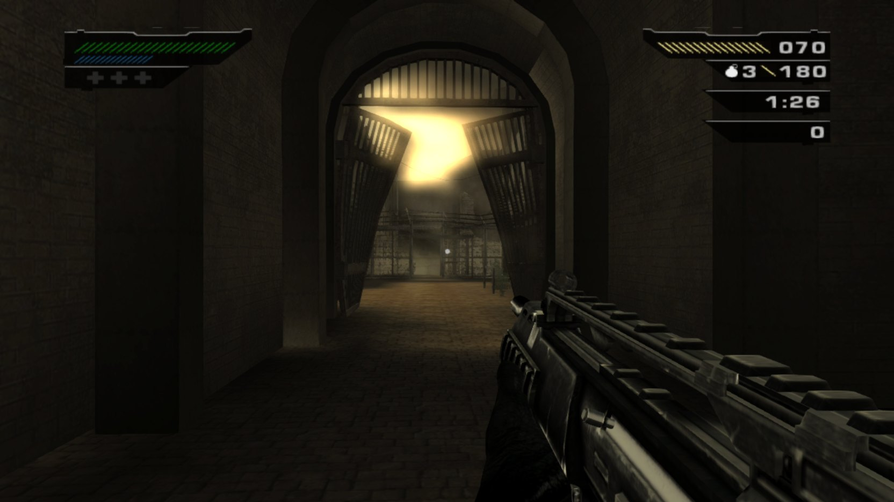
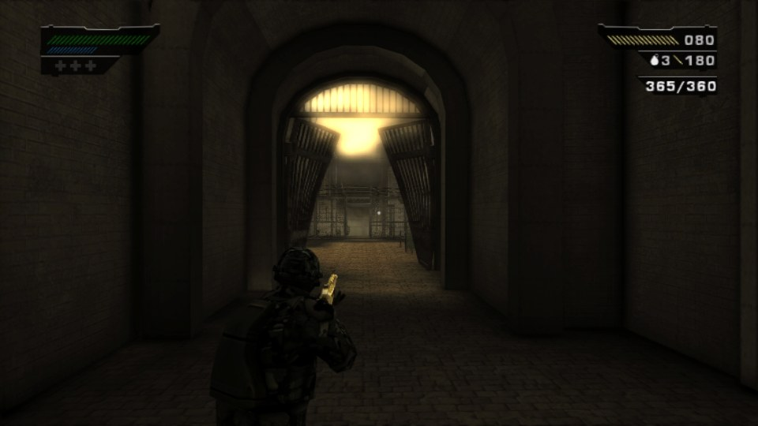
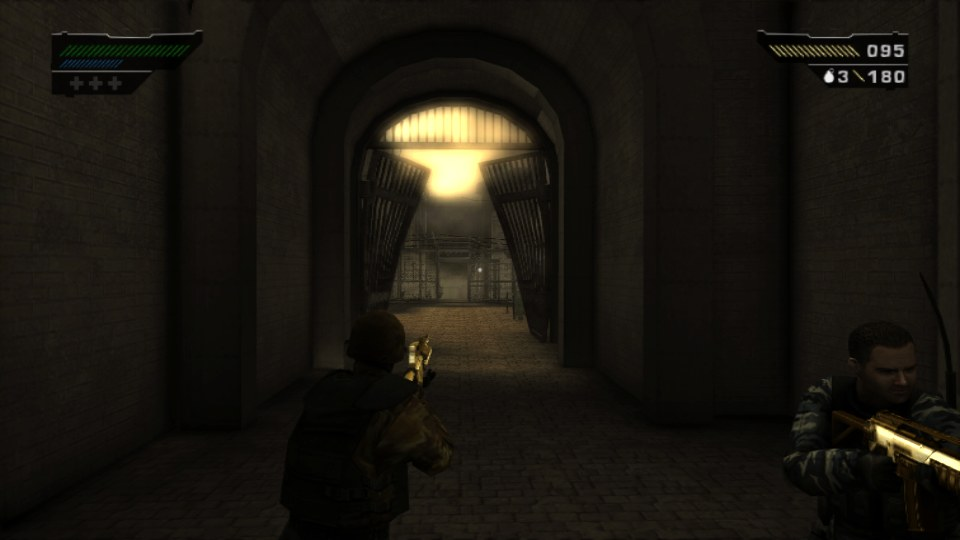
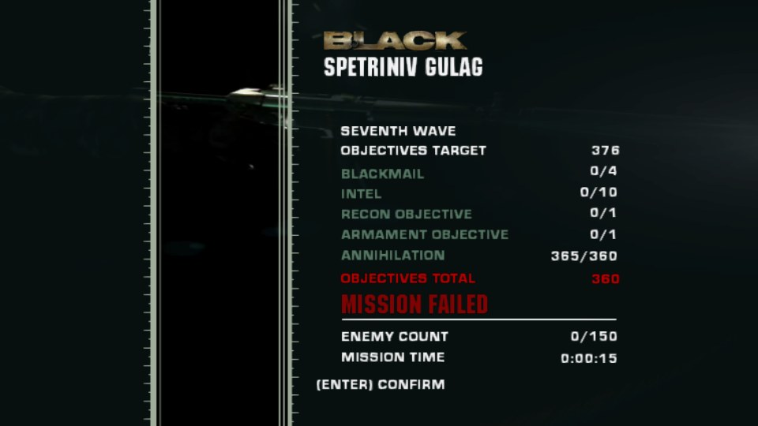
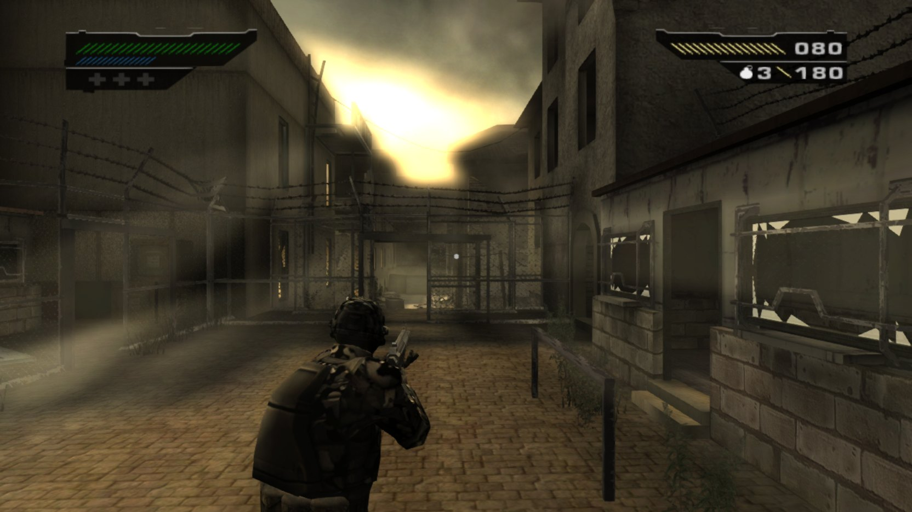
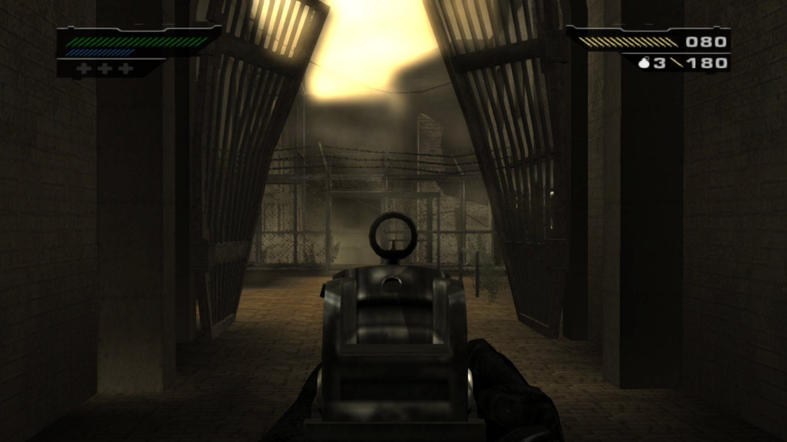
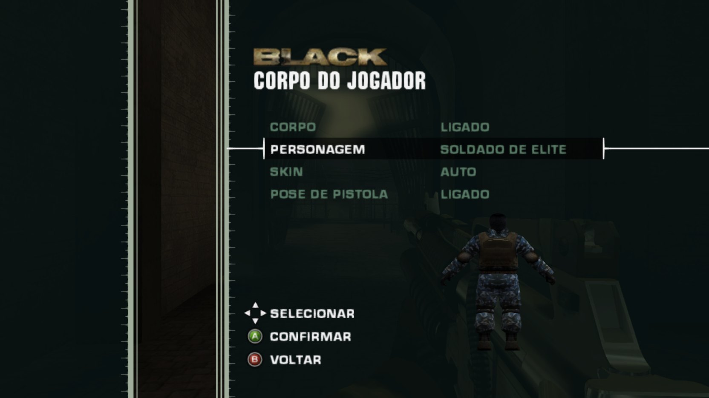
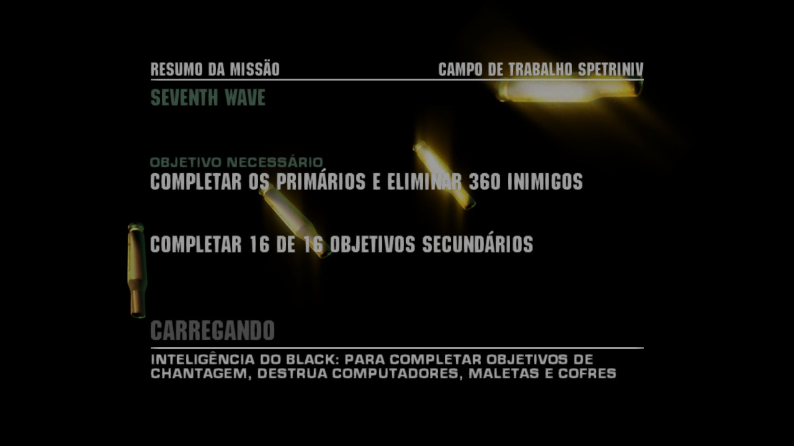

# BLACK Reloaded Mod

**Mods for BLACK (Criterion Games, 2006) in a single `winmm.dll`: jump, sprint, noclip, fall damage, free camera,
third person with a body, modern aim, cheats, gold weapons, enemy multiplier, squad mode, the challenge mode that was
cut from the game, speedrun, a fifth difficulty and a MODS page inside the pause menu, where almost everything turns
on, off and is adjusted while you play.**

[**Download**](../../releases/latest) · [Português (Brasil)](README.pt-BR.md) · [Install](#install) ·
[The mods](#the-mods) · [Troubleshooting](#troubleshooting)

Version **1.9** comes in two builds, one for each way of playing BLACK on PC:

| | XBE Recomp | PC port by Spark198 |
|---|---|---|
| Made for | the XBE Recomp of BLACK | the PC port of BLACK, version 0.2.0 |
| Your copy of the game | the NTSC-U Xbox disc image | the NTSC-U Xbox disc with the PT-BR translation |
| Language of the mod | English | Brazilian Portuguese |
| Mods | 24 | 29 |
| Package | `BLACK_Reloaded_Mod_1.9_XBERecomp.zip` | `BLACK_Reloaded_Mod_1.9_Port_Spark198_PTBR.zip` |

Both builds have the same gameplay mods. The recomp build adds the clean sound mode. The port build adds the reload
blur removal (the recomp has its own option for it), the PC SETTINGS in Portuguese, text and menu fixes for the
translation, faster menu texts and a crash log. Each package's `winmm.dll` works only with its own build.

## Contents

- [Highlights](#highlights)
- [Requirements](#requirements)
- [Install](#install)
- [Update and uninstall](#update-and-uninstall)
- [Keys](#keys)
- [The mods](#the-mods)
- [Challenge mode](#challenge-mode)
- [Seventh Wave](#seventh-wave)
- [Rewards](#rewards)
- [The MODS page and black_mods.ini](#the-mods-page-and-black_modsini)
- [How it works](#how-it-works)
- [Troubleshooting](#troubleshooting)
- [Screenshots](#screenshots)
- [Version history](#version-history)
- [Rights](#rights)
- [Credits](#credits)

## Highlights

- **The challenge mode is back.** The mode that was cut from the game returns on the main menu: Killing Time and Head
  Count, with medals and records per level, plus a speedrun mode for the full missions.
- **Third person with a real body.** Switch between first person, a camera behind the character and one over the
  shoulder. A character stands in for the player, with 10 models and a skin for each mission, and turns on a display
  on the MODS page.
- **A fifth difficulty, the Seventh Wave.** Black Ops with twice the enemies, no healthpacks and a minimum of fallen
  enemies to finish each mission.
- **Everything in the pause menu.** The MODS page holds every option. Each change applies at once and is saved.
- **Rewards for playing it straight.** Missions finished without mods unlock the silver M16A2, the Seventh Wave, the
  gold weapons and the cheats.
- **No game files.** The mod's menu pages, texts and gold textures are made on the spot from your own copy of the game.
- **Fixes of the game.** A crash in the collision test, a crash at checkpoints and a menu glitch of the Seventh Wave are
  fixed.

## Requirements

**XBE Recomp build**

- The XBE Recomp of BLACK working with your copy of the game: `BLACK.exe`, the `compiler` folder and the NTSC-U disc
  image in the `assets` folder.
- Keep the `compiler` folder: the mod installs itself through it.

**PC port build**

- The PC port of BLACK by Spark198, version 0.2.0 (`black.exe` and `blackrt.dll`), working with your copy of the game.
- The NTSC-U Xbox disc with the PT-BR translation.

## Install

Download the package for your build from the [Releases](../../releases/latest) page and unzip it.

### XBE Recomp

1. Copy `winmm.dll` into the folder where `BLACK.exe` is:

   ```
   BLACK XBERecomp\
     assets\          (the disc image)
     compiler\
     hdd\
     BLACK.exe
     winmm.dll        <- the mod
   ```

2. Start the game with `BLACK.exe`, as usual.

The first time, the mod adds its hooks to the recomp's build and the recomp compiles the game again, which takes a
moment. When the recomp asks "The game is ready. Start the game now?", leave **Delete the compiler files** unticked.
**CHALLENGE MODE** shows up on the main menu and **MODS** on the pause menu.

### PC port (Spark198)

1. Copy `winmm.dll` into the folder where `black.exe` is. In the port 0.2.0 it is the `port` folder, beside `game`:

   ```
   BLACK\
     game\          (the disc files)
     port\
       black.exe
       blackrt.dll
       winmm.dll    <- the mod
   ```

2. Start the game with `black.exe`, as usual.

The first time, the mod creates `black_mods.ini` and builds its menu pages from your game's own. **MODO DESAFIO**
shows up on the main menu and **MODS** on the pause menu. There is no installer to run.

## Update and uninstall

**Update (both builds):** swap `winmm.dll` for the new one. Your options (`black_mods.ini`), your progress and your
records stay; new options start at their defaults. On the recomp, the game compiles again on the next start when the
new version has other hooks.

**Uninstall the XBE Recomp build:** with the game closed, run `Uninstall BLACK Reloaded Mod.bat` (in the package) from
the folder of `BLACK.exe`. It puts back the recomp's original build files (`compiler\config\game.toml` and
`compiler\BLACK.lib`), deletes `winmm.dll` and `Black.dll`, and the recomp compiles the original game on the next
start. Do not just delete `winmm.dll`: the game the recomp compiled with the mod needs it to start. If you want, also
delete `black_mods.ini`, the `black_mods*.log` files, `black_mods_gold.dat`, `black_mods_challenges.ini` and the
`hdd\E\TDATA\45410083\ReloadedMod` folder.

**Uninstall the PC port build:** delete `winmm.dll`. If you want, also delete `black_mods.ini`, the logs and the
`black_mods_menus` and `black_mods_ouro` folders.

## Keys

| Key | What it does |
|---|---|
| `C` | jump |
| `LCtrl` (hold) | sprint |
| `F1` | free camera |
| `F2` | hide and show the HUD |
| `F3` | first person → third person → over the shoulder |
| `F4` | noclip |
| `F9` | save the last 30 seconds of sound (XBE Recomp only) |

Every key and option can be changed on the MODS page or in `black_mods.ini`.

## The mods

Almost every mod turns on and off on the MODS page and applies in the same game. Mods marked *Recomp only* or
*Port only* exist in one build.

### Movement

- **Jump** (`C`): the character can jump. Speed and gravity can be adjusted, and each jump costs 15% of the sprint's
  stamina.
- **Sprint** (`LCtrl`, hold): runs 1.6× faster, moving forward only. The stamina lasts 6 s and shows as a blue bar below
  the health. In third person the body's running animation plays at 1.3×.
- **Noclip** (`F4`): goes through walls, floors and objects and flies where you look, without losing control of the
  weapon. Good for exploring the levels for hidden things.
- **Fall damage:** falls hurt, measured from the highest point of the fall. Nothing up to 3 m, then more and more until
  a fall of 12 m kills. Both heights can be changed.

### Camera and visuals

- **Free camera** (`F1`): a loose camera that flies around the level while the game keeps running. The mouse wheel
  changes its speed.
- **HUD key** (`F2`): hides and shows the HUD. It comes back by itself on pauses, menus and cutscenes, so no message is
  ever hidden.
- **Third person** (`F3`): switches between first person, a camera behind the character and a camera over the shoulder.
  The camera avoids walls, the shot goes along the line of the crosshair, and aiming or reloading can go back to first
  person.
- **Player body:** in third person a character stands in for the player, with 10 models to choose from (3 allies and 7
  enemies) and, for most soldiers, the skin of each mission they appear in. On the MODS page (PLAYER BODY) the chosen
  character turns on a display beside the options. He holds the same weapon, walks, crouches and points where the
  crosshair hits. An enemy model is drawn over the ally's moves, so every model aims the same way and none holds a
  shield. The body stays still while the free camera looks around, and only the footsteps of the character in view
  play.
- **Modern aim:** when aiming, the weapon goes to the line of sight, with the rear and front sights at the centre of the
  screen, and stays still even while walking. The shotguns aim the same way. Weapons without an aim pose, like the P90,
  keep their crosshair.
- **Yellow filter:** removes the yellowish tint of the missions and makes the fog neutral.
- **Reload blur** (*Port only*): removes the screen blur the game adds while reloading. On the recomp, this option is in
  its own OPTIONS > RECOMP SETTINGS.

### Weapons and combat

- **Reload:** each weapon has two reload animations, the combat one and the calm one. ORIGINAL lets the game choose,
  FAST always uses the weapon's shorter one and SLOW the longer one.
- **Cheats:** invincible, infinite ammo, no reload, infinite grenades, one-shot kills and infinite stamina. Locked until
  the Seventh Wave reward.
- **Silver weapons:** turns on the infinite ammo of the game's own silver weapons. The option only shows after the game
  unlocks them.
- **Gold weapons:** every weapon tinted gold, the RPG and the grenade launcher too, with double damage on the enemies.
  The Seventh Wave reward.
- **Silver M16A2:** the Black Ops reward, with an option to turn it on and off. Never on the Seventh Wave or in the
  challenge mode.

### Enemies and allies

- **Enemy multiplier:** each enemy gets copies, from 1× to 3×. The copies spawn in a safe spot, move alongside the
  original and fight the same way. Those of RPG soldiers spawn farther away, so they do not block each other's shots.
- **Squad mode:** 1 or 2 allies follow and fight with you. When they fall behind, they run after you or are brought
  closer, and at checkpoints they regroup with you.

### Modes and difficulties

- **Challenge mode:** the mode that was cut from the game, back on the main menu. See [Challenge mode](#challenge-mode).
- **Speedrun:** the full mission with a timer and every mod locked. The records of each mission and difficulty are in
  the OPERATOR PROFILE.
- **Black Ops with or without mods:** when you choose Black Ops, the game asks whether you want to play with or without
  mods. The missions finished without mods get a gold BLACK OPS.
- **Seventh Wave:** a fifth difficulty. See [Seventh Wave](#seventh-wave).

### Sound (*Recomp only*)

- **Clean sound:** fixes the fried sound of the firefights. The game's sounds (most of them 22 to 44 kHz) are brought to
  48 kHz through a proper filter instead of straight lines between samples, which left a grainy edge on the gunfire.
  The echo of the shots and explosions is resampled with a filter too, without its hiss and metallic edge. A limiter
  holds the loud moments just under the clipping point instead of letting them clip. The game mixes very loud (about
  -10 LUFS in firefights), so the mod plays it at 50% (about -16 LUFS). `F9` saves the last 30 seconds of sound. The
  options are in `[audio]` of `black_mods.ini`. On by default.

### Interface, translation and tools

- **MODS page:** every option of the mod inside the pause menu. See
  [The MODS page and black_mods.ini](#the-mods-page-and-black_modsini).
- **Mod log:** `black_mods.log` records what each mod did. DETAILED LOG, in MODS > EFFECTS AND LOG, helps track down
  problems.
- **PC SETTINGS in Portuguese** (*Port only*): the PC settings translated, on the main menu and on the pause menu. QUIT
  became SAIR.
- **Text fixes** (*Port only*): BLACK OPS in place of "Black", MISSÃO FRACASSADA and the descriptions of the Hard and
  Black Ops difficulties.
- **Menu fixes** (*Port only*): the highlight bars cover the Portuguese texts, and the ON/OFF of the pause OPTIONS no
  longer overlaps.
- **Faster menu texts** (*Port only*): the menu texts appear at twice the speed, without touching the panels' slide.
- **Crash log** (*Port only*): when the game closes with an error, the port's log of that game is kept in
  `black_falha_anterior.log`.

### Fixes of the game

- **Volumes on the same point:** the game's collision test crashed when two round volumes (characters, bodies) ended up
  on exactly the same point, which the copies of the multiplier and of the Seventh Wave make possible. The two are now
  pushed apart instead.
- **Checkpoints and restarts:** an animation lookup without an animation tree no longer crashes the game. The body, the
  copies and the rest of each level's state start over on every load, checkpoint and RESTART MISSION.
- **Leaving the Seventh Wave:** leaving a Seventh Wave mission through the pause menu left SEVENTH WAVE twice on the
  difficulty page. The run now ends on the menus.

## Challenge mode

The game still holds what is left of a challenge mode that was cut before release. The mod brings it back as
**CHALLENGE MODE** on the main menu (**MODO DESAFIO** on the port): choose a level, a type and a difficulty.

| Type | Goal |
|---|---|
| Killing Time | a timer runs down and each kill gives more time |
| Head Count | the most headshots |
| Speedrun | the full mission with a timer and every mod locked |

Killing Time and Head Count have medals and records per level. The speedrun records of each mission and difficulty are
in the OPERATOR PROFILE. The challenge always uses its own weapon, even with the silver M16A2 turned on.



## Seventh Wave

mods. It is Black Ops with:

- twice the enemies;
- a 2% chance of health per enemy and no healthpacks;
- no M16A2;
- the **annihilation** objective instead of the destruction one: kill a minimum of enemies in each mission, shown as
  fallen/minimum on the panel, the pause menu and the results.

| Mission | Minimum of fallen enemies |
|---|---|
| 1. Veblensk | 120 |
| 2. Treneska | 240 |
| 3. Nazran Town | 250 |
| 4. Nazran Foundry | 300 |
| 5. Tivliz | 270 |
| 6. Vratska | 260 |
| 7. Graznei | 220 |
| 8. Spetriniv | 360 |

Killing more never raises the minimum.



## Rewards

| Stage | How | Unlocks |
|---|---|---|
| 1 | the 8 missions on Black Ops without mods | the silver M16A2 and the Seventh Wave difficulty |
| 2 | the 8 missions on the Seventh Wave without mods | the gold weapons and the cheats |

A mission counts when it is played from start to finish without mods (the PLAY WITHOUT MODS answer) and with the
required objectives met. The progress is kept in `black_mods_gold.dat` (`black_mods_ouro.dat` on the port).

## The MODS page and black_mods.ini

On the pause menu, **MODS** opens every option of the mod. Each change applies at once and is saved in
`black_mods.ini`, which the mod creates next to `winmm.dll` on the first start. On a key or button row, confirm and
press the key (or button) you want; `Esc` gives up. Left and right also go through the list.

You can also edit `black_mods.ini` with the game closed. The recomp's sound options are only there, in `[audio]`.

## How it works

- Windows loads a `winmm.dll` found in the game's folder. The mod's DLL passes the real calls on to Windows' own
  `winmm.dll` and starts the mod.
- **PC port:** the mod changes the game's code in memory when it starts. Nothing in the game's folder is overwritten.
- **XBE Recomp:** the recomp compiles the Xbox game into a PC program. On the first start the mod adds its hooks to the
  recomp's build (keeping the original files as `game.toml.original` and `BLACK_original.lib`), and the recomp
  compiles the game again with them.
- The mod's menu pages are built at start from your game's own menu files, by a patch inside the DLL that holds only the
  mod's own data. Each original page is checked first; one that does not match stays off and the log says so. The gold
  textures are made the same way, from your copy's weapon textures.
- With another version of the game, of the port or of the recomp, the parts that do not match stay off and the log
  says what.

## Troubleshooting

- **What did the mod do?** `black_mods.log`, next to `winmm.dll`, shows what each mod did and what stayed off. The last
  three sessions' logs are kept as `black_mods_previous1..3.log` (`black_mods_anterior1..3.log` on the port).
- **The mod's menus do not show (port).** The port build needs the NTSC-U disc with the PT-BR translation. With another
  region or translation, the mod's pages stay off and the log says so.
- **The mod does not install itself (recomp).** The recomp's `compiler` folder is needed. If it was deleted, reinstall
  the recomp and copy `winmm.dll` again. When the recomp asks to start the game, leave **Delete the compiler files**
  unticked.
- **The first start takes longer (recomp).** It is the recomp compiling the game with the mod's hooks. It happens again
  only when a new version has other hooks.
- **The sound seems blown out (recomp).** The game mixes very loud, over YouTube and 6 to 13 dB over other games. The mod
  plays it at 50% (`volume = 50` in `[audio]`; 100 is the game's own level). Windows can still change the sound after
  the mod: Bass Boost or Loudness Equalization in the output device's Enhancements make the shots and explosions much
  louder. `black_mods.log` says on each start whether the device has them on. `F9` right after a moment that sounds
  wrong saves what the game sent.
- **The game crashed (port).** The port's log of that game is kept in `black_falha_anterior.log`.

## Screenshots

| | |
|---|---|
|  |  |
| Third person with the player body and the squad (XBE Recomp) | The Seventh Wave results (XBE Recomp) |
|  |  |
| Third person (PC port) | Modern aim (PC port) |
|  |  |
| The character display (PC port) | The annihilation objective on the loading screen (PC port) |

## Version history

**1.9**
- Character display on MODS > PLAYER BODY and a SKIN row with the outfit of each mission.
- The 7 enemy models are only a look over the ally's skeleton: they all aim, walk and turn the same way, and none holds
  a shield. Pistol pose on every model.
- The free camera no longer moves the body; only the footsteps of the character in view play; the body runs 1.3×
  faster.
- Seventh Wave: a fixed minimum of fallen enemies per mission, shown as fallen/minimum.
- New cheat: INFINITE STAMINA.
- The P90's crosshair stays on screen when aiming; RPG soldiers' copies spawn 4 m away.
- Fixes: the gold M16A2 no longer tints the arms; the silver M16A2 no longer replaces the challenge's weapon; a crash
  at checkpoints with the body; the state of each level starts over on every load (enemies no longer stand idle at the
  start of a level). Recomp: the gold weapons' firing sound is no longer distorted.

**1.8**
- XBE Recomp: first release, in English, with every mod of the port build, the clean sound mode and the MODS page
  rebuilt for the recomp.
- PC port: the mod is named BLACK Reloaded Mod; fall damage; menu texts at twice the speed; the "Reloaded Mod © 2026
  Kromer" footer on the main menu.

**1.7**
- PC port: first release, with 27 mods, the MODS page, the challenge mode, speedrun, Black Ops with or without mods,
  the Seventh Wave, the gold weapons and the PC SETTINGS in Portuguese.

The full changelog of each build is in `CHANGELOG.md` inside its package.

## Rights

© 2026 Kromer. All rights reserved. The mod's code is closed: only `winmm.dll` is distributed. You may download, use and
share the packages for free, unchanged. Selling the mod, distributing modified versions of `winmm.dll` or decompiling
it to distribute its code is not allowed. See [`LICENSE.txt`](LICENSE.txt).

BLACK is a trademark and property of Criterion Games and Electronic Arts. This is a fan project with no ties to them,
and it ships no game file. You need your own copy of the game.

## Credits

- **BLACK:** Criterion Games and Electronic Arts.
- **PC port of BLACK:** Spark198.
- **XBE Recomp of BLACK:** its authors.
- **BLACK Reloaded Mod:** Kromer.
